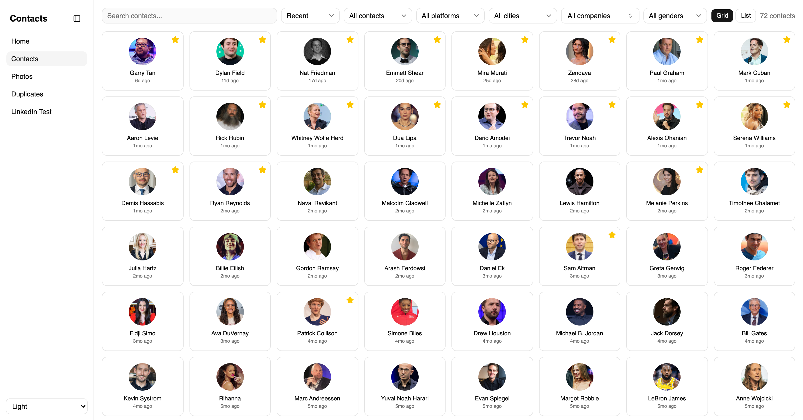
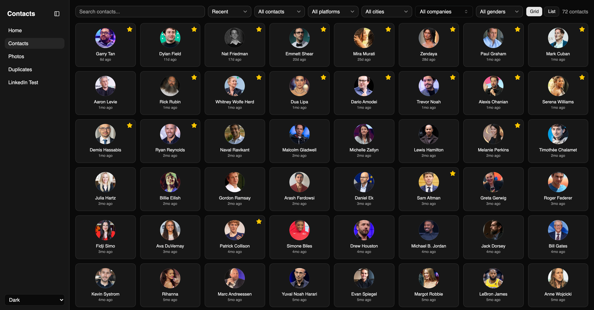
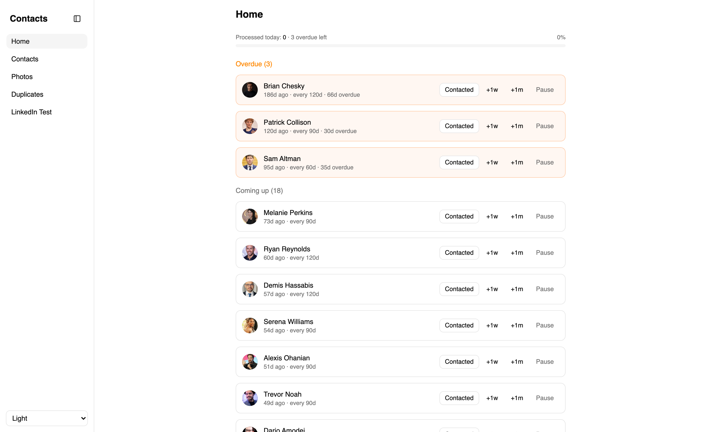
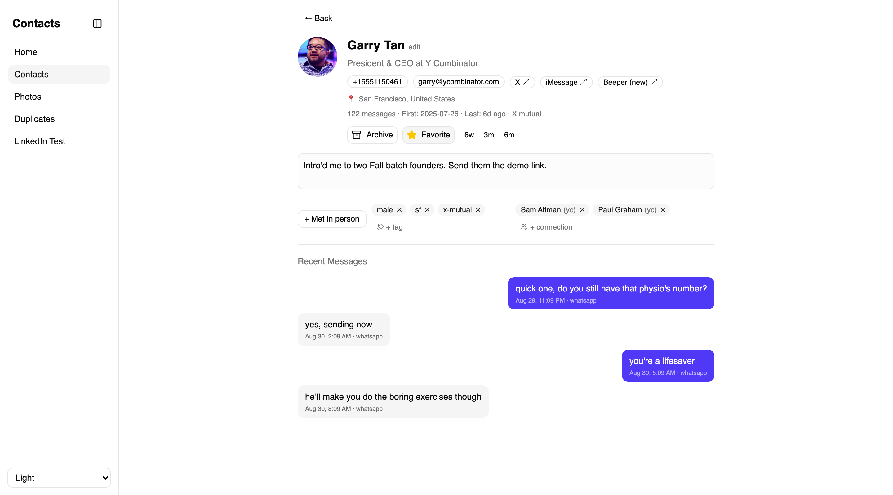
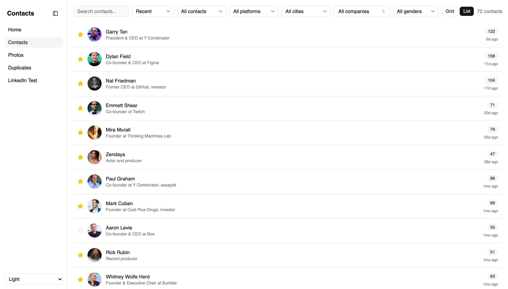

# Orbit

**An open-source, local-first personal CRM.** It auto-imports your contacts from **15+ sources**, merges the duplicates, and surfaces the people you have not spoken to in a while. Deno + React + SQLite, and everything stays on your machine in a single file.

- **No manual data entry.** Unlike Dex, Clay and Folk, Orbit pulls from the platforms you already use instead of asking you to type people in.
- **CLI-first.** Unlike [Monica](https://github.com/monicahq/monica), the main open-source alternative, it is built to sit alongside AI coding agents like Claude Code.
- **Queryable by an agent.** One SQLite file holds messages, LinkedIn profiles, calendar events and tags, so you can ask *"Who in my contacts works in philanthropy?"* or *"When did I last talk to anyone at a16z?"* and have the agent search, pull context, and add people to a Google Sheet for outreach.



<details>
<summary>More screenshots</summary>

**Dark mode:**



**Home** - who's overdue, with a one-click "contacted" log:



**Contact detail** - headline, tags, connections, and the merged message history across every platform:



**List view:**



</details>

> The screenshots show a demo database of 72 public figures, not anyone's real
> contacts. See [Demo data](#demo-data) to regenerate it.

## Features

- Auto-import from 15+ sources (see table below)
- Fuzzy duplicate detection + merge UI with redirect tracking for re-import stability
- LinkedIn/Instagram profile enrichment via RapidAPI
- Stay-in-touch reminders with snooze and "contacted" logging
- Contact timeline (messages, calls, calendar events, manual notes across all sources)
- Profile picture pipeline (Apple Contacts, LinkedIn, image search)
- Google Sheets integration for outreach tracking
- Favorites, tags, archive, notes
- Filter by platform, city, company or favorites; connect contacts to each other
- Search contacts by name, with vim-style keyboard shortcuts and a light/dark theme
- CLI lookup tool (`deno task lookup "name"`)

## Setup

1. Install [Deno](https://deno.com) and [Node.js](https://nodejs.org)
2. Clone this repo
3. Grant your terminal **Full Disk Access** (System Settings > Privacy & Security) for iMessage/WhatsApp/Call History
4. Copy `server/.env.example` to `server/.env` and fill in API keys (optional, only needed for enrichment)
5. Run:

```bash
npm install --prefix client    # Install client dependencies
./dev.sh                       # Start server + client at http://localhost:5173
deno task sync                 # Import iMessage, WhatsApp, calls, Apple Contacts + dedup
```

Your `crm.db` SQLite database will be created automatically on first sync.

## Import Sources

| Source | Script | Data imported | How to get the export |
|--------|--------|---------------|----------------------|
| iMessage | [`import-imessage.ts`](server/src/import-imessage.ts) | Messages, contacts | Automatic (reads `~/Library/Messages/chat.db`) |
| WhatsApp | [`import-whatsapp.ts`](server/src/import-whatsapp.ts) | Messages | Automatic (reads WhatsApp Desktop local DB) |
| Apple Contacts | [`import-contacts.ts`](server/src/import-contacts.ts) | Names, phones, emails, photos | Automatic (reads `~/Library/Application Support/AddressBook/`) |
| Call History | [`import-call-history.ts`](server/src/import-call-history.ts) | Phone calls | Automatic (reads macOS `CallHistory.storedata`) |
| LinkedIn | [`import-linkedin.ts`](server/src/import-linkedin.ts) | Connections, company, title | [Download your data](https://www.linkedin.com/mypreferences/d/download-my-data) > Connections CSV |
| X/Twitter | [`import-x.ts`](server/src/import-x.ts) | Followers, following, bios | Any Chrome extension that exports followers/following as CSV |
| X/Twitter DMs | [`import-twitter-dms.ts`](server/src/import-twitter-dms.ts) | DM history | [Twitter data export](https://x.com/settings/download_your_data) |
| Instagram | [`import-instagram.ts`](server/src/import-instagram.ts) | DMs, followers | [Download your information](https://www.instagram.com/accounts/privacy_and_security/) |
| Facebook | [`import-facebook.ts`](server/src/import-facebook.ts) | Messenger history | [Download your information](https://www.facebook.com/dyi) (JSON format) |
| Google Calendar | [`import-google-calendar.ts`](server/src/import-google-calendar.ts) | Meeting attendees | [Google Takeout](https://takeout.google.com) > Calendar, or calendar.google.com > Settings > Export |
| Google Contacts | [`import-google-contacts.ts`](server/src/import-google-contacts.ts) | Email addresses | [contacts.google.com](https://contacts.google.com) > Export > Google CSV |
| Gmail | [`import-mbox-contacts.ts`](server/src/import-mbox-contacts.ts) | Email sender names | [Google Takeout](https://takeout.google.com) > Mail > mbox format |
| Substack | [`import-substack.ts`](server/src/import-substack.ts) | Subscribers | Substack dashboard > Subscribers > Export |
| Beeper | [`import-beeper-threads.ts`](server/src/import-beeper-threads.ts) | Thread links per contact | Automatic (reads the local Beeper Desktop API) |
| LinkedIn enrichment | [`enrich-linkedin.ts`](server/src/enrich-linkedin.ts) | Full profile, experience, education | [Fresh LinkedIn Profile Data](https://rapidapi.com/freshdata-freshdata-default/api/fresh-linkedin-profile-data) (RapidAPI) |
| Instagram enrichment | [`enrich-instagram.ts`](server/src/enrich-instagram.ts) | Bio, follower count | [Instagram Scraper 2025](https://rapidapi.com/social-starter/api/instagram-scraper-20251) (RapidAPI) |

## Import Commands

Some importers have a named task; the rest are run through `deno task run`.
Both forms are listed below, run them from the repo root.

```bash
# Core sync (run regularly to pick up new messages)
deno task sync

# Social platforms (run after downloading new exports)
deno task import-linkedin                             # Connections.csv from exports/
deno task --cwd server run src/import-x.ts            # Twitter CSV from exports/ or ~/Downloads
deno task --cwd server run src/import-twitter-dms.ts  # DM history from the Twitter export
deno task --cwd server run src/import-instagram.ts    # Instagram JSON export from exports/
deno task --cwd server run src/import-facebook.ts     # Facebook JSON export from exports/
deno task --cwd server run src/import-substack.ts     # Substack subscriber CSV
deno task --cwd server run src/import-beeper-threads.ts

# Google data (run after Google Takeout / calendar export)
deno task --cwd server run src/import-google-contacts.ts   # ~/Downloads/google-contacts.csv
deno task --cwd server run src/import-google-calendar.ts   # ICS files (unzip Takeout to /tmp/gcal_export/)
deno task import-mbox                                      # mbox From headers for email->name mapping

# Enrichment (uses RapidAPI credits)
deno task enrich-linkedin 100                          # Enrich next 100 unenriched contacts
deno task --cwd server run src/enrich-instagram.ts     # Bio + follower counts

# Cleanup passes
deno task dedup                                        # Fuzzy duplicate detection
deno task dedup-phones
deno task --cwd server run src/normalize-locations.ts  # Collapse city spellings for the filter
```

## Google Sheets Integration

For outreach tracking via Google Sheets:

1. Create an OAuth 2.0 Web Client in [Google Cloud Console](https://console.cloud.google.com/apis/credentials)
2. Add `http://localhost:3000/oauth2callback` as an authorized redirect URI
3. Set `GOOGLE_CLIENT_ID` and `GOOGLE_CLIENT_SECRET` in `server/.env`
4. Run `deno task run src/sheets-auth.ts` and complete the OAuth flow in your browser
5. Token is saved to `.sheets-token.json` (gitignored) and auto-refreshes

## Tips

**Recommended import order** for best contact matching:
1. `deno task sync` (iMessage, WhatsApp, Apple Contacts - gives you names + phone numbers)
2. `import-linkedin` (adds email addresses + company/title)
3. `import-x.ts` (adds Twitter usernames, profile pics)
4. `import-google-contacts.ts` (links more email addresses to existing contacts)
5. `import-mbox` (builds email->name map from Gmail, links calendar attendees)
6. `import-google-calendar.ts` (matches attendees by email - needs emails from steps 2-5)

**The mbox trick**: Google Calendar ICS files often have email-only attendees (no display names). The mbox import parses `From:` headers from your Gmail export to build a 15k+ email->name mapping, which dramatically improves calendar attendee matching.

**Browsing your data**: Install [DB Browser for SQLite](https://sqlitebrowser.org/) or [TablePlus](https://tableplus.com/) to browse `crm.db` directly. Useful for ad-hoc queries the web UI doesn't cover.

**CLI lookup**: Quick contact info without opening the browser:
```
$ deno task lookup "Isaiah"

=== Jane Smith (id: 42) ===
LinkedIn: Software Engineer at Acme Corp
Messages: 812 | First: 2022-03-15 | Last: 2026-04-10
Phones: +15551234567
Emails: jane@example.com

Recent messages:
  2026-04-10 [imessage] them: sounds good!
  2026-04-09 [imessage] me: want to grab coffee this week?
  2026-03-15 [calendar] me: 1:1 catch-up (+1 attendees)
```

## How It Works

The CRM uses a merge-redirect system for re-import stability: when you merge two contacts, it records which source IDs (Apple Contacts ID, LinkedIn URL, X username, email) pointed to the merged-away contact, so the next time you re-import, the data flows to the correct contact automatically.

Each import script is idempotent - you can re-run them safely. Messages are deduped by source-specific IDs (iMessage ROWID, etc.), and contacts are matched by email > phone > name.

## Tech Stack

- **Server**: Deno, SQLite (`@db/sqlite`), HTTP API
- **Client**: React, Vite, Tailwind CSS, shadcn/ui (base-ui)
- **Data**: Single SQLite file (`crm.db`), profile photos on disk

## Demo data

The screenshots above run against a throwaway database of 72 public figures
from tech, film, music, sport and writing, with profile pictures pulled from
Wikipedia. It never touches your real `crm.db`.

```bash
CRM_DB_PATH=$PWD/exports/demo.db CRM_PHOTOS_DIR=$PWD/exports/demo-photos \
  deno task --cwd server seed-demo     # 72 contacts + photos (cached after the first run)

CRM_DB_PATH=$PWD/exports/demo.db CRM_PHOTOS_DIR=$PWD/exports/demo-photos \
  deno task --cwd server start         # then start the client against it
```

`CRM_DB_PATH` and `CRM_PHOTOS_DIR` override the defaults (`crm.db` and
`exports/contact-photos/`) for any script, so nothing else needs changing. Both
demo files live under `exports/`, which is gitignored.

Wikipedia's lead images are mostly conference and red-carpet shots, so each one
is reframed into a head-and-shoulders avatar by
[`server/tools/facecrop.swift`](server/tools/facecrop.swift), which finds the
largest face with Apple's Vision framework. It is built on first run and
skipped if Swift is unavailable, in which case the uncropped image is used.

## License

MIT
